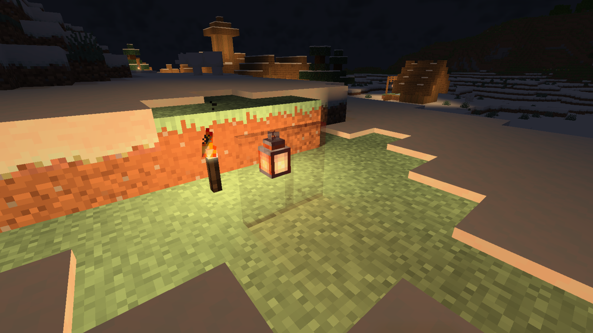

# 画面に届く色ガラスの光

赤窓がカメラの背後にあるとき、画面内に透過光が届くかどうかは、窓自体の見え方だけでは分からない。画面を16×9に区切り、描画済みの不透明面から各ピクセルの受光位置を復元する版を検証した。松明の光路に板ガラスが入る可能性のある区画を窓用プログラムが描き、ほかの区画を通常のプログラムが描く。影や透過光そのものは各ピクセルで計算する。

- 赤窓を正面から見る検査室では、144区画中65区画を窓用に割り当てた。消灯した窓や照明の範囲外の窓は通常の経路で扱える。受光セルの境界では両側を調べる。画面領域の判定は不透明物の描画後、二つの照明プログラムの直前に行う。[検査室の区画数](screen-grid/edges.json)・[Irisの描画順序](https://shaders.properties/current/reference/programs/overview/)
- 1279×719で、全144区画の四隅・辺の中央・区画中央の各9点を毎フレーム調べた。連続3,400フレーム、五つの出力先のフレーム番号・経路ID不一致は0。うち1,269フレームで両経路が同じ画面を分担した。[境界の検査](screen-grid/edges.json)
- 通常の白樺林で松明を4本置いた画面では83.91 ms。カメラの背後に6枚の赤い板ガラスを加えた画面では84.98 ms。後者はワールド内に対象の光路があり、実際の画面内で窓用に割り当てられた区画は0だった。2560×1440、12チャンク、GPUタイムスタンプ無効での平均フレーム間隔。[通常の林](screen-birch/summary.json)・[背後に赤窓を置いた林](screen-rear/summary.json)・[描画中の区画数](screen-birch-mask/edges.json)
- 板なしの部屋で27.15 ms、赤窓で44.64 ms。7場面で対応づけた同じ壁の101,668点について、8ビットの透過RGBは元のSunlit-Panes版と一致した。この比較では、両方のゲーム起動で同じと確認できた受光座標を採用した。[通常描画](screen-room/summary.json)・[透過色の照合](screen-optics/transmission.json)

## 窓を背にして透過光を見る

Fableの提案に従い、カメラを赤窓と白壁の間に入れ、窓を背にして壁を見た。検査専用ZIPで、通常・窓用が分担して描いた不透明面の色をRGBA32Fに保存した。そのフレームの深度、面、光源、時刻を維持したまま、全画面を窓用の処理でもう一度描いた。性能測定では通常描画のZIPを使用した。[助言](advisor.txt)・[比較の実装](behind_window.py)

正面、窓の背後の3視点、牛を配置した場面を合わせ、1280×720の全4,608,000画素を照合。全画面計算でガラスの光路記録に触れたのにタイル版でその処理を省いた画素は0。窓の背後の3視点では、各画像で14.25万画素以上に着色があり、隣り合う視点の移動幅は0.4 mm。固定露出で双方を8ビットに変換すると、5画像のうち計8画素で1階調だけ差があった。2階調以上の差は0。ここで照合したのは不透明面に対する照明で、水面や水中をこの実測に含めていない。[全画素の照合](screen-behind-pane/comparison.json)

背後の窓を置いた林の最初の全画面版の起動では、到着直後の状態確認に失敗した。その後の周回で状態は整ったが、この起動を時間比較から除外し、林に到着してから窓と松明を置く形で比較した。[最初の起動のログ](../2026-11-23-window-routing/back-window-selective/client.log)

## 同一条件の通常フレーム

単位はミリ秒。全画面切替は Window-Routing、区画分担は Window-Tiles。点灯した板を背にした林でも、松明の数・位置・カメラ・板の6ブロックを揃えて3種類のZIPを比べた。白樺と背後の窓の試験では松明を置く前に同じ林を読み込んだ。

| 場面 | 元のSunlit-Panes | 全画面切替 | 区画分担 |
| --- | ---: | ---: | ---: |
| 赤窓の部屋 | 62.90 | 47.62 | 44.64 |
| 板なしの部屋 | 26.49 | 26.37 | 27.15 |
| 白樺林・松明4本 | 83.82 | 83.74 | 83.91 |
| 白樺林・松明4本・背後に赤窓 | 85.01 | 111.44 | 84.98 |

背後の窓は全画面切替から26.46 ms短縮。窓のない部屋では元版を0.66 ms上回った。白樺林4本の負荷自体は約84 msある。表は別々のゲーム起動で得た平均値で、小数点以下の差から安定した性能差は判定できない。[背後の窓の元版](../2026-11-23-window-routing/back-window-control-warm/summary.json)・[全画面切替](../2026-11-23-window-routing/back-window-selective-warm/summary.json)・[区画分担](screen-rear/summary.json)

コンパイル検査の初回は、エンティティの影用に設けていた「1回に三角形1枚」の検査を画面描画にも適用して失敗した。影用プログラムの条件を維持し、画面描画では各ドライバの出力上限とジオメトリシェーダーの実行数上限を検査するよう変更した。[最初の検査結果](compile-mesa-original-check.txt)

## GPUでの内訳とビルド

選んだZIPは `python3 tools/build.py --window-tiles` で再生成できる。Minecraft用の照明コンパイラ0.3.0と一緒に隔離環境で使用した。パック内の41プログラムのコンパイル・リンクはNVIDIAとMesa llvmpipeの双方で成功した。[配布用ZIP](../../dist/Aqualumen-Window-Tiles.zip)・[照明コンパイラ](../../dist/aqualumen-lighting-compiler-0.3.0.jar)・[ZIPのSHA-256](build.json)・[NVIDIA](compile-nvidia.txt)・[Mesa](compile-mesa.txt)

GPUタイムスタンプを有効にして赤窓を先に撮った別起動では、220フレームのGPU平均が区画の判定0.19 ms、通常照明5.54 ms、窓用照明17.25 msだった。板なしの部屋372フレームは順に0.006、9.68、0.006 ms。上の通常フレーム間隔の表はタイムスタンプを切った起動である。[GPU計測](gp-screen-window-reverse/draws.json)・[選定時の計測・画質照合](decision.json)

## ガラス越しに見る灯り

雪原のゲーム画面では板の輪郭に比べて面の赤が淡い。配布ZIPの処理を調べると、カメラから見る板はテクスチャで着色した面を通常のアルファで重ねている。Minecraft 1.21.1の赤ガラスの中央テクセルはアルファ102/255で、頂点アルファ1の単一面なら背景から取り込む割合はRGBとも0.60になる。一方、松明の光路に使う色付き吸収は厚みに依存し、同じ赤板を垂直に1枚通るとパックの係数ではRGBが約0.980、0.818、0.795倍になる。これは表示されたピクセルの明るさそのものではなく、二つの経路で採用しているモデルの差である。[バニラ素材と配布ZIPの照合](visible-pane.json)

## 遊べるセーブと通常Lab

同じ村の世界を2回続けて歩いた。1回目は雪原にランタンを設置して帰宅し、2回目はそのランタンのそばに赤い板ガラス2枚と松明1本を置いた。暗くなった雪原でガラスの反対側から灯りを撮影した。2回目の帰りは玄関で自動歩行が設定距離を行き過ぎたため、保存された玄関の位置から再開。しゃがんで入室し、家の中で保存した。2回目の実プレイはティック58,423から70,284まで連続し、元のセーブと前半・後半の位置・時刻・歩行統計を照合した。ゲームの歩行統計では163.81 m、玄関の再開分は0 m。3シード合計は136,684ティック、5.695マイクラ日、1,489.29 mとなった。[雪原での記録](../2026-11-22-ceiling-return/village/dusk-glass-on-the-snow-trail/complete.json)・[帰宅の記録](../2026-11-22-ceiling-return/village/dusk-glass-home/complete.json)・[重複を除いた累計](playtime.json)

新しいセーブを開くと窓のある家の中から再開する。雪原の松明とランタン、赤い板の東西の接続、所持している板13枚・松明30本を保存データから確認した。玄関で止まった回のログには、ゲームが終了処理に入った後にローカル接続が閉じた旨のINFOが1件ある。その後、全ディメンションのディスク保存が完了している。以前の記録を保存したまま、検証器で終了順序を照合した。[引き続き遊べるセーブ](../../dist/Aqualumen-Snowfield-Red-Glass.zip)・[セーブ内容とSHA](../2026-11-22-ceiling-return/village/dusk-glass-home/save.json)・[帰宅後の画面](../2026-11-22-ceiling-return/village/dusk-glass-home/home-after-dusk-ingame.png)

通常Labの選択はAqualumen 1.8.0、physics 0.2.0。全測定後に元のインスタンスの状態と照合した。通常版のGPU回帰検査と雨よけの検査102項目もRTXで成功した。[通常版の検査ログ](ordinary-release-check.txt)
