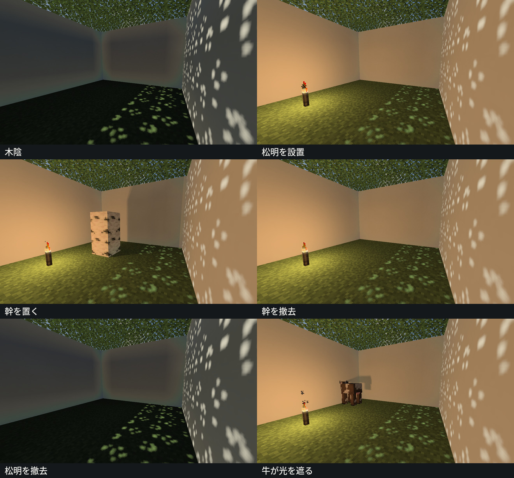

# 木陰に置いた松明の可視率をワールド座標で再利用する試作

比較元には水膜補正版を使った。オークの木目と夜道の段差については、既に試した露出変更で木目の改善が小さく、足元が暗くなったため、今回の3方式はすべて同じ露出・反射・葉の透過を使う。設置した松明の光線を省ける範囲だけを変えた。[露出比較](../2026-11-23-torch-density/README.md)・[水膜補正版](../2026-11-23-wet-receiver/README.md)

## 何をVRAMに残したか

地形の占有状態、設置光源の位置と種類から、受光点のある立方体と光源の円盤をすべて囲む直方体を調べる。中が空なら、その立方体の内部から円盤のどの点へ引いた線分も空間を通る。この「全透過」を光源ごとに1ビットで保存する。画面に最後に映った色や反射光、部分的に隠れた光源の可視率はこのビットに含まれない。現在の動物の境界にかかるとき、手持ち光源、葉の裏を通る光、境界の数値許容幅に入ったときは元の照明処理に進む。

一辺64 mの領域に1 m単位でビットを保存する。8 m区画の絶対位置、光源リストの順序と発光形状、周囲の占有ビットを毎フレーム調べる。地形が変わった場合は光が届く半径を覆う近傍の区画で判定を作り直す。視点が動いても、同じワールド位置を指す区画は使い続けられる。リングバッファの同じメモリ番地に別の地形が入った場合は作り直す。割り当てを増やした画像は R32F の512×608テクセル、1.1875 MiB。これはシェーダーの画像容量である。[変更の検出](cell_changes.csh)・[可視区間の計算](cell_build.csh)・[描画時の読み出し](cell_query.glsl)

先に作った比較用の方式は、各フレームで64³セルの占有数を3軸に沿って累積する。画素ごとに8か所を読んで、発光円盤を含む直方体内の個数を調べる。この方式には時間方向の再利用がない。白樺林の2560×1440の実画面で横1画素おきに測ると、4,844,600件の設置光源照会のうち2,602,044件が全透過で、同じフレームの元の光線計算との不一致は0。通常描画の平均フレーム間隔は61.47 msから63.66 msに延びた。Fableが指摘した「省略できるのが元々軽い光線に偏る」可能性は、ヒット件数だけでは排除できない。[最初の試作](open.glsl)・[アドバイザーへの質問](advisor-question.txt)・[回答](advisor.txt)

## 葉の屋根、白樺の幹、牛

RTX 3080 Tiで動くMinecraft 1.21.1とIris 1.8.8に、前のフレームから再利用する版を読み込んだ。隔離コピーで時刻9800に固定し、白樺の葉で覆った部屋の草地に松明を立て、間に高さ2ブロックの白樺の幹を置いた。カメラをX=409.48から407.83に移して8 m区画の境を越え、元の位置で幹を切り、松明を外した。最後に松明を戻して牛を歩かせた。牛の開始から終了までの変位は4.44 m。[場面と設置座標](room.py)・[通常描画の収録](grove-cell/complete.json)・[比較元](grove-control/complete.json)

設置松明が直接見える同じ草地121,659地点では、点火で8ビット表示輝度が中央値49.03階調上がった。幹によって可視率が1→0、撤去で1に戻った草地は5,662地点、背後の壁は41,593地点。該当する床の表示RGB中央値は、点火前 (11,15,10)、点火後 (52,51,21)、幹あり (34,35,16)、幹撤去後 (52,51,22)、消灯後 (11,15,10) だった。幹が直射を遮ったときにも、床には天空光や反射光が届いている。各値は固定視点のゲーム内写真で求め、受光面は深度から復元したワールド座標で照合した。[読出しの実装](results.py)・[各段階の測定条件](grove-cell-meter/geometry.json)

## 白樺林の通常プレイと照合

2560×1440、12チャンク、松明4本、両手を空にした同じ白樺林で、GPUタイムスタンプを外してゲームの描画フレーム間隔を測った。「順方向」は水膜補正版→キャッシュ版、「逆方向」はキャッシュ版→水膜補正版。各窓は10秒以上。順方向の2本の間には別の診断起動が入っている。

| 通常描画 | フレーム数 | 平均間隔 | 99%点 |
| --- | ---: | ---: | ---: |
| 順方向・水膜補正版 | 163 | 61.47 ms | 67.13 ms |
| 順方向・キャッシュ版 | 169 | 59.35 ms | 65.27 ms |
| 逆方向・キャッシュ版 | 170 | 59.09 ms | 64.76 ms |
| 逆方向・水膜補正版 | 164 | 61.14 ms | 68.35 ms |

キャッシュ版の短縮は2.11 msと2.05 ms。実ゲームの別の診断起動では、最前面の地形に対する4,850,858件の設置光源照会のうち2,550,888件が前フレーム以前の全透過ビットを利用できた。同一フレームで元の光線も追跡し、RGBのいずれかが1と異なった件数は0。通常描画同士の静止した樹皮57,350画素と遠い草10,400画素では、各方式で得た3枚のチャンネル値の範囲が全地点で重なった。先行する反射計算順の約4 msは別の比較である。[撮影ログ・フレーム・差分](results.json)・[設置光源キャッシュの診断画像](../2026-11-23-torch-density/gp-density-open-volume-cell-readout/birch-4-ingame.png)

## キャッシュの書き換え

実機で使ったZIPの計算シェーダーを、RTX 3080 TiとMesa llvmpipeでも同じ入力列で駆動した。初期化前のメモリに37を書き、初回構築・静止・幹の追加・部分遮蔽材への差し替え・撤去・光源の並べ替え・消灯中の葉の変更・再点灯・発光面の拡大・視点の8 m移動・64 m周回・帰還を検査した。各フレームでCPUは元の遮蔽物リストを直接走査した。14段階、各環境603,136件のセル×光源の判定が一致した。8 m移動直後には空と判定した10,207件のうち9,503件で前回の計算を使えた。64 mの移動先で以前と同じメモリ番地を使った場合の再利用は0件。ここでの数値は人工配置におけるGPU読み戻しで、ゲーム内フレーム時間とは別の測定である。[独立照合](cache_probe.cpp)・[RTX](cache-probe-rtx.log)・[Mesa](cache-probe-mesa.log)

[通常描画のキャッシュ実験版ZIP](../../dist/Aqualumen-Torch-Cell-Study.zip) は、実Minecraftで使った通常版と同一の SHA-256 `e1e06b864967cd61305931d499f71a8f0f07eb66d5696c49eb3a5ecd36903671`。リポジトリ直下から `python3 reports/2026-11-23-torch-open-volume/cell_pack.py --export` で元の水膜補正版を基に再現できる。一般プレビューは13のまま。Fableの最終助言も、改善が約3%にとどまること、異なる環境での結果がまだ少ないことから、任意の実験版とするものだった。[実測を添えた質問](advisor-results-question.txt)・[回答](advisor-results.txt)

## 設置・撤去の途中

通常描画とは別の診断版で、画面の横1画素おきにGPUが数えた照会数・全透過の判定数・元の計算との不一致を読み出した。RGBのどれかが1から外れれば不一致と数える。再利用した区画と、そのフレームで作り直した区画も区別した。消灯時は設置松明の照会数が0になり、点灯時と同じ座標の草地に残光は見られなかった。

私有ウィンドウの512×256画素を毎秒30コマで可逆収録した。最初の収録では開始ログの発話者名が想定と違い、録画を視点移動の段階から接続した。設置直後については同じ元セーブから、松明と幹の最初の設置だけを別途撮影した。両方とも隣の画像とバイト単位で同一のコマを重ねて数えていない。これはその範囲と収録時刻の測定結果で、ゲームが描いた全フレーム・全画素を表すものではない。

| 収録範囲 | 取得コマ | 直前と異なるコマ（先頭含む） | 全透過の判定 | 過去フレームから再利用 | 不一致 |
| --- | ---: | ---: | ---: | ---: | ---: |
| 木陰から松明・幹を置く | 657 | 26 | 1,481,475 | 1,376,456 | 0 |
| 視点移動から幹の撤去、消灯、再点灯、牛が去るまで | 1,687 | 396 | 17,914,423 | 17,848,916 | 0 |

牛を置いた段階のF2で、設置松明を調べた446,730件はすべて動物が遮る可能性があると判定され、キャッシュを使わず実フレームの遮蔽処理を通った。牛が去った後の同じ視点では452,317件中425,955件で以前の全透過ビットを使えた。[設置時の可逆動画](grove-placement/transitions.mp4)・[移動・撤去・牛の可逆動画](grove-cell-meter/late-transitions.mp4)・[数値](results.json)

## 通常サバイバルの岩棚

プレビュー13で前回のサバイバルセーブを開き、青い魂のランタンを残した岩棚の石を木のつるはしで1ブロック掘った。くぼみの背面に暖色の松明を掛けると、くぼみと手前の草に光が届いた。入口の小径まで6.05 m戻って、岩の下から見える青い光と、くぼみの脇に残る暖色を確認した。自然な時刻・天候のまま1,124ティック進んだ。再開用アーカイブ内の壁掛け松明・支持する石・青いランタン・湖畔の二つの灯りも確認した。固定時刻の森・部屋の測定を除いた3シード累計は83,233ティック、3.46804ゲーム日、929.48 m。[実画面](stone-niche.jpg)・[保存したブロック](../2026-11-21-animal-light/woodland/stone-torch-niche/save.json)・[遊べるセーブ](../../dist/Aqualumen-Torch-Niche.zip)・[連続したプレイ記録](playtime.json)

実ゲームの構成はMinecraft 1.21.1、Iris 1.8.8、Sodium 0.6.9と[Aqualumen照明コンパイラ0.3.0](../../dist/aqualumen-lighting-compiler-0.3.0.jar)。検証はすべて隔離コピーを使い、元のLabの選択は `Aqualumen-1.8.0.zip` だった。実行前後の設定と保存元の照合も通った。ShellCheck 0.9.0でプロファイラのビルドスクリプトを再検査し、既存のMesaトレースはapitrace 11.1で画素読出しまで確認し、実Minecraftの既存のSQLite記録はNsight Systems 2026.5.2で再集計できた。今回のフレーム間隔はMinecraftのフレーム観測MODで、次のパス別の時間は専用のGPUタイムスタンプで収録している。[元のLabの照合](grove-cell/preflight.json)・[先行する実MinecraftのNsight収録](../2026-11-23-torch-density/nsight-minecraft.json)

## 松明の本数とGPU時間

同じ白樺林に専用プロファイラを入れ、キャッシュ版では0・1・2・4本、水膜補正版では0・4本でGPUタイムスタンプを取った。各行は1回、10秒以上の窓に含まれる全フレームの平均。ここでの「地形の照明」は最前面の地形に局所光を加える遅延描画、「葉・草」は切り抜き地形の描画区間。GPUフレームには表にない処理も含まれる。

| パック・松明 | GPUフレーム | 地形の照明 | 葉・草 | 第1反射のための光の計算 |
| --- | ---: | ---: | ---: | ---: |
| 水膜補正版・0本 | 30.82 ms | 1.66 ms | 10.54 ms | 0.96 ms |
| 水膜補正版・4本 | 56.97 ms | 15.37 ms | 11.27 ms | 6.88 ms |
| キャッシュ・0本 | 30.89 ms | 1.66 ms | 10.76 ms | 0.97 ms |
| キャッシュ・1本 | 41.19 ms | 5.55 ms | 11.07 ms | 2.48 ms |
| キャッシュ・2本 | 46.31 ms | 8.22 ms | 11.13 ms | 4.20 ms |
| キャッシュ・4本 | 55.01 ms | 13.67 ms | 11.23 ms | 6.81 ms |

4本でGPUフレームが1.96 ms短くなり、そのうち1.70 msは最前面の地形を照らすパスで観測された。追加した区画変更検出と再構築のディスパッチは、静止した4灯の窓で平均が各0.008 ms。地形を壊し続けたときの最悪値はこの窓からは求められない。0本時のGPUフレームの差は0.07 msだった。キャッシュ版で0本から4本に増やすと、地形の照明が12.01 ms、反射光を出す面の計算が5.84 ms増える。木陰の画質と負荷を次に詰める場所は、地形の照明で現在も光線を追う、葉や幹が松明を部分的に隠す領域である。遮蔽物の種類別の時間はこのGPU計測では分解していない。[6条件の平均・全区間](gpu-times.json)・[計器の検査と収録](profile.py)・[各パスの集計](profile_result.py)
