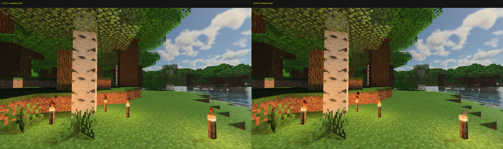
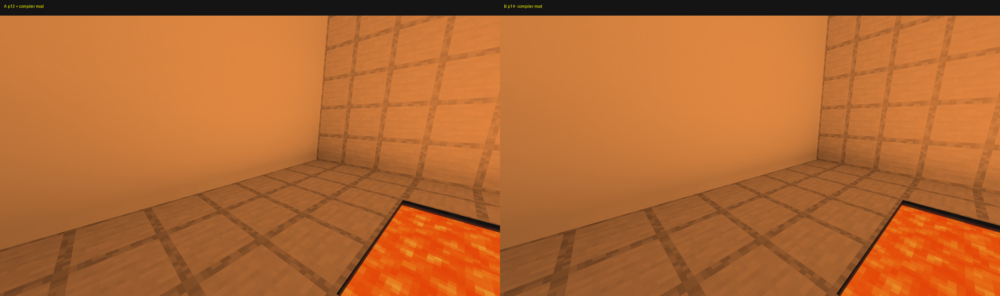
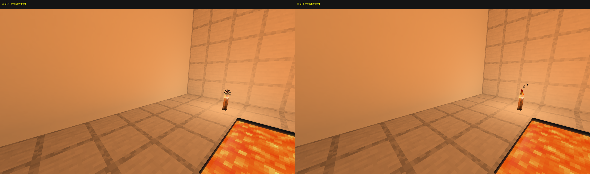
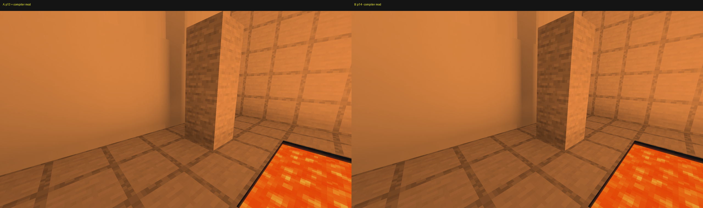
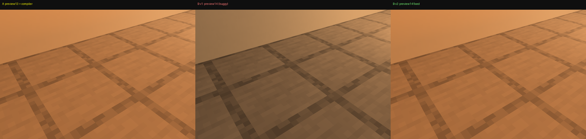

# 照明コンパイラなしで動く溶岩の面光源

Iris 1.8.8 の JCPP 前処理は `#pragma` 行を落とすため、NVIDIA ドライバーへ渡す inline 指示は照明コンパイラ Mod からしか注入できない。プレビュー13を Mod なしでコンパイルすると、この PC の RTX 3080 Ti / ドライバー 580.173.02 では `gbuffers_water` が `too many instructions` で失敗した。プレビュー14はこの Mod を外しても全 21 プログラムがリンクできる構成で、溶岩の面光源の厳密な計算は、不透明地形の光を解決する `deferred.fsh` と、反射・面キャッシュへ書き出す `shadowcomp2.csh` の 2 つに限定した。それ以外の描画プログラムは溶岩の面光源を計算せず、水面・生き物・手持ち・半透明の面が受ける溶岩光は面光源モデルをやめて従来のブロック光（1.8.0 と同じ扱い）に戻る。これは意図した見た目の差で、不透明地形が受ける溶岩光とその影はプレビュー13と同じ厳密な計算のまま。[変更したレイヤー](../../release/compile-budget/)・[検証データ](runs/)

## GPU ハーネスでのコンパイル時間

EGL の互換コンテキストで全プログラムを展開・コンパイル・リンクし、NVIDIA のディスクシェーダーキャッシュを毎回新しい場所に向けて冷間にした。これは GPU ハーネスの計測で、Minecraft の読み込み時間ではない。ハーネスのツールと生データは作業用ディレクトリ `/tmp/aq-p14/` と `/tmp/aq-compile/` に残した。

| 構成 | 合計 | 結果 |
| --- | ---: | --- |
| 1.8.0（参照） | 約 50.2 s | 20 プログラム全てリンク |
| プレビュー13・Mod あり | 43.6 s | 21 プログラム全てリンク |
| プレビュー13・Mod なし | 失敗 | `gbuffers_water` が命令数上限でリンク不可 |
| **プレビュー14・Mod なし** | **186.2 s** | **21 プログラム全てリンク（水が通る）** |
| プレビュー14・Mod あり | 24.7 s | 21 プログラム全てリンク |

Mod なしでは `deferred.fsh` が面光源の部分木をそのまま抱えるため、合計は 1.8.0 より長い。deferred が約 76 s、水が約 34 s を占め、残りは 9〜15 s に下がって水もリンクできる。Mod を併用すると inline 指定で副プログラム呼び出しに変わり、計測した全構成で最速の 24.7 s になった。

## ゲーム内での確認

Minecraft 1.21.1、Iris 1.8.8、Sodium 0.6.9、RTX 3080 Ti、2560×1440、描画距離 12 チャンク。隔離したコピーを VirtualGL と専用 Xvfb で起動し、A B C C B A の順に 6 回起動した。A はプレビュー13＋コンパイラ Mod、B はプレビュー14で Mod の JAR を起動前に取り除いたもの、C はプレビュー14＋コンパイラ Mod。[起動と計測の記録](run_verification.py)・[各回の完了記録](runs/)

各回とも白樺林の松明 4 本と溶岩 4 場面（`lava1-open`・`lava9-open`・`torch-lava9-open`・`lava9-pillar`）を同じ視点・時刻で撮り、完了時に元の Lab の設定とワールドが変わっていないことを照合した。全 6 回でシェーダーのコンパイルエラーは 0 件だった。Mod を外した B の 2 回でも `too many instructions` やリンク失敗は出なかった。

| 起動 | 構成 | 白樺 4 本 CPU 平均 ms | 白樺 4 本 GPU フレーム ms | 溶岩 9 面 CPU 平均 ms | 溶岩 9 面 GPU フレーム ms |
| --- | --- | ---: | ---: | ---: | ---: |
| a1 | A・p13＋Mod | 61.5 | 56.1 | 58.7 | 54.4 |
| b1 | B・p14 Mod なし | 65.0 | 59.6 | 61.6 | 57.1 |
| c1 | C・p14＋Mod | 60.5 | 55.0 | 57.6 | 53.3 |
| c2 | C・p14＋Mod | 59.9 | 55.0 | 57.7 | 53.5 |
| b2 | B・p14 Mod なし | 63.8 | 58.6 | 61.2 | 56.6 |
| a2 | A・p13＋Mod | 65.7 | 60.5 | 60.3 | 55.5 |

GPU プロファイラの区間を構成ごとにまとめると、composite はプレビュー14で約 3 分の 1（2.2〜2.5 ms → 0.77〜0.80 ms）になった。溶岩の面光源を計算しなくなった分で、B と C で同じだけ下がる。deferred は C が A とほぼ同じ時間なのに対し、B は Mod がないため inline 展開され、白樺で +3.7 ms、溶岩の場面で +2.2〜5.7 ms 遅くなった。deferred のシェーダー自体はプレビュー13と機能的に同じで、差は Mod の有無だけ。shadowcomp と prepare は構成間でほぼ同じだった。B のフレーム全体は A とほぼ同等で、C が最も速い。

なお b1 の `lava1-open` では deferred が 16.7 ms・フレーム 31.8 ms と、同じ構成の b2（51.7 ms・64.7 ms）や他の全起動（46〜52 ms）から外れた値を記録した。撮影画像は A とほぼ一致しており描画内容は正しいため、GPU タイマーの一時的な外れ値として集計から除いた。

## 見た目の一致

同じステージの F2 画面を画素ごとに比べた。A（a2）と B（b2）の平均 RGB 差は、`lava1-open` 0.03、`lava9-open` 0.10、`lava9-pillar` 0.09、`torch-lava9-open` 0.32、`birch-4` 0.60（松明の炎や粒子の時間差によるもので、照明の差ではない）。溶岩が面光源として効く場面でもプレビュー13とほぼ同じ絵になった。A と C（a1 対 c1）は `lava9-open` で 0.001、`torch-lava9-open` で 0.009 と、実質的に一致した。

## 最初の版で見つかった退行と修正

`shadowcomp2.csh` は `deferred.fsh` が読む反射・面キャッシュの面積行を書き出す計算シェーダーだが、最初のプレビュー14 では `AQUALUMEN_LAVA_AREA_EXACT` を定義していなかった。そのため面光源の呼び出しが外れて `areaDiffuse` が 0 になり、溶岩の光が反射経路から届かなかった。ゲーム内の比較で溶岩の場面がプレビュー13と平均 RGB 差 17.8〜26.9 ずれたことで見つけ、同じシェーダーに define を足して再ビルドした。修正後は同じ比較が 0.00〜0.21 に戻った。下は左からプレビュー13、修正前のプレビュー14、修正後のプレビュー14 の同じ瞬間で、修正前だけ溶岩の照り返しが落ちている。

## 限界

ゲーム内の 6 回はすべて NVIDIA のディスクシェーダーキャッシュが温かい状態で、パック読み込みから最初の描画までは全構成で約 8.6〜10.1 秒だった。冷間のゲーム内コンパイル時間は測っていない。Mod なしで初回にコンパイルする時間は上の GPU ハーネスの 186 秒が対応する。検証は NVIDIA のみで、AMD・Intel では未確認。deferred を Mod なしで動かすと inline 展開のため数 ms 遅くなる点は、Mod を併用すれば解消する。
